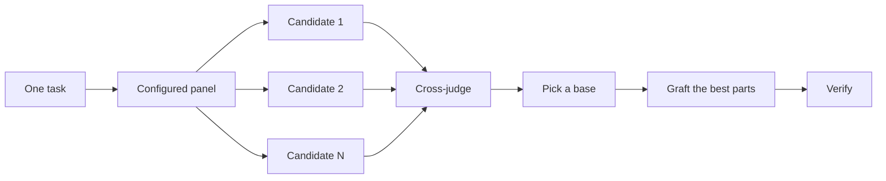

# Design before you write code

> Originally by [poteto](https://github.com/poteto) for [Cursor pstack](https://github.com/cursor/plugins/tree/main/pstack). Adapted for Hermes Agent.

One attempt at a hard design locks in the first shape the model thought of. `pstack:architect` settles types and boundaries before implementation. `pstack:interrogate` has other models try to break the result. When the job is coverage rather than design synthesis, `pstack:swarm` fans out slices or races and aggregates their results.

## Settle the shape with `pstack:architect`

```text
load pstack:architect design the import pipeline before writing any code. i care most about how callers use it.
```

[`pstack:architect`](../../skills/architect/SKILL.md) traces every system the change touches first. Then it sketches two different shapes, each with types, signatures, and module boundaries, and picks the one where each piece of state has one owner, each task has one way to do it, and callers need to know least. For a large or contested design, it runs parallel `delegate_task` candidates or `pstack:interrogate` instead of sketching alone. If you want to see the design before any code, say so in the prompt.

The design isn't sacred once code starts. If the same workaround keeps coming back, `pstack:architect` redesigns instead of patching around it.

## Fan out attempts with competitive design rounds

For problems where independent attempts would help (naming, formats, algorithms), you can ask the agent to run multiple delegate_task workers on the same brief in parallel. Each writes to its own directory. A read-only judge, on a different model family when your configuration allows one, scores every candidate against a rubric. The coordinator reads each candidate end to end, picks a base, grafts in the best ideas from the losers, and verifies the result.



The runners use the delegate model set by [`pstack:setup-pstack`](../../skills/setup-pstack/SKILL.md). Change `delegation.model` between runs if you want different models in the panel.

## Cover slices and races with `pstack:swarm`

```text
load pstack:swarm check every package under packages/ against its check.sh. one worker per package. one report.
```

[`pstack:swarm`](../../skills/swarm/SKILL.md) fans N workers across independent slices, coverage matrices, gauntlet lanes, exploration partitions, or declared race arms. Each worker gets its own scope and check, then reports `PASS`, `ISSUES`, or `BLOCKED`. The parent waits for the workers and returns one compact report with any gaps or dropouts.

Reach for it when parallelism buys coverage or lets independent checks race. Competitive design rounds give every worker the same brief, then pick a base and graft the best parts. `pstack:swarm` covers slices or runs a race with a selection rule declared up front. It does not use the base-selection and grafting ceremony.

## Break it with `pstack:interrogate`

```text
load pstack:interrogate the whole branch, but skeptically. no nitpicks unless it's an actual bug or regression.
```

[`pstack:interrogate`](../../skills/interrogate/SKILL.md) gives the change and its intent to adversaries spawned with `delegate_task`, and each tries to break it with a run against the real code. Adversaries find different failures. A finding survives only when rerunning its command shows a failure that breaks the intent. The report lists every verified finding with the adversaries that found it, then what each adversary dropped and why, and applies nothing.

Read the Dropped list too. You can override the verdict.

## How much design work does a task deserve?

You might be wondering whether every change needs this. No. Most changes need none of it. A rough ladder:

- A small, finished change you're unsure about needs `pstack:interrogate` alone.
- A change that crosses function boundaries or moves ownership earns `pstack:architect`, which brings competitive design rounds with it when the design is large or contested.
- A standalone decision where independent attempts would help, like naming, formats, or an algorithm, can use competitive design rounds directly via delegate_task.
- A coverage matrix, set of parallel checks, or race with declared arms is `pstack:swarm`.
- A contested design that's expensive to reverse gets `pstack:architect`, then `pstack:interrogate` before shipping.

`pstack:poteto-mode` already applies this ladder. Boundary-crossing work triggers `pstack:architect` on its own, so you reach for these directly mainly when you want more or less scrutiny than the default.

Next: [Build and clean the change](./05-build-and-clean.md).
